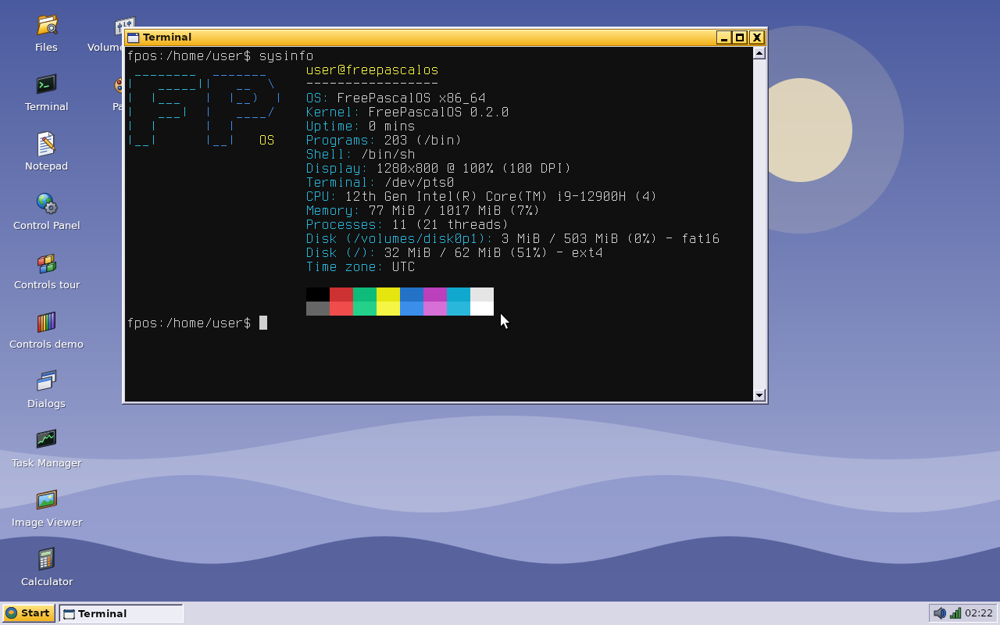
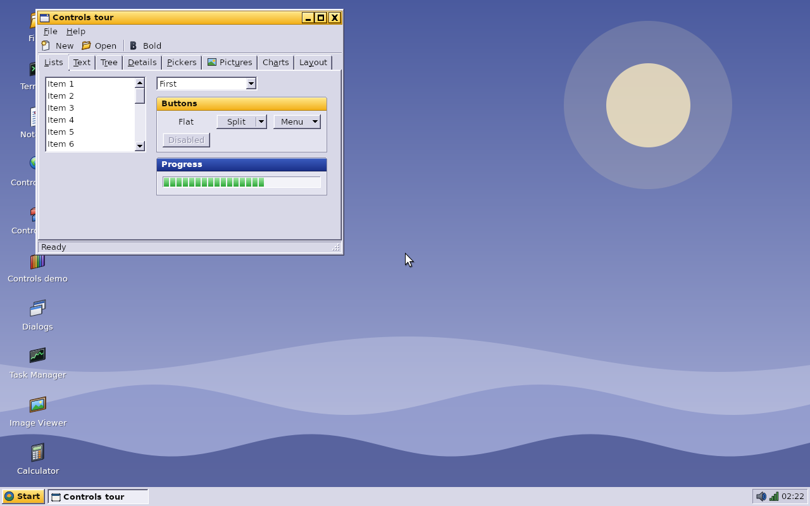
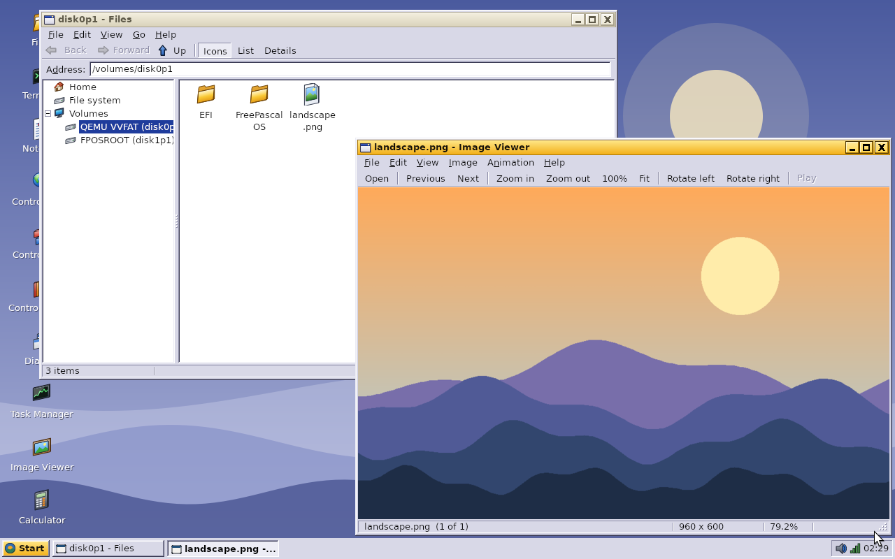
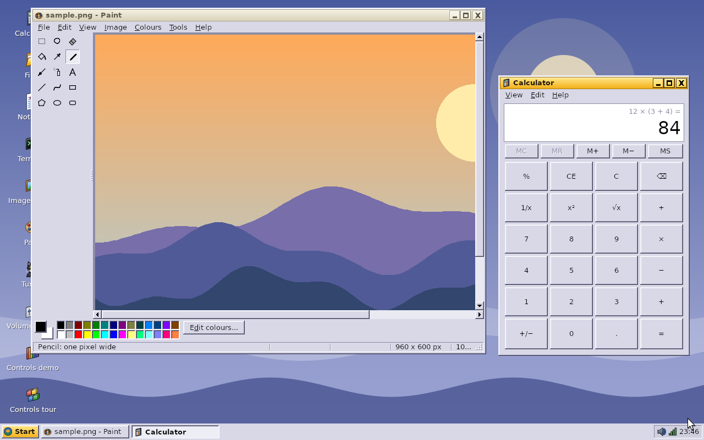

# FreePascalOS

A small, modern operating system written in Free Pascal (with inline assembly
where the hardware requires it), for 64-bit UEFI machines. The kernel is
layered in the style of Windows NT: a hardware abstraction layer at the
bottom, a kernel core for scheduling and synchronization, and executive-style
subsystems (memory, objects, processes) on top.

The first target is x86-64. A 64-bit ARM (AArch64) port for the Raspberry
Pi 4 with UEFI firmware has begun: it supplies its own versions of the
architecture specific units, and the kernel boots to the end of its self
tests in QEMU's virt machine; see "The AArch64 port" in
[docs/Architecture.md](docs/Architecture.md).

## Screenshots

The desktop in the default theme, running in QEMU at 1280×800. They are
taken by `scripts/take-screenshots.py` from the plans in
[docs/screenshots/plans](docs/screenshots/plans), e.g.
`scripts/take-screenshots.py docs/screenshots/plans/sysinfo.json`.

| | |
|---|---|
|  |  |
| A terminal running `sysinfo` | The controls tour: banded group boxes, split buttons, progress |
|  |  |
| Files and the image viewer | Paint and the calculator |

## What works today

- A UEFI loader that finds the framebuffer and ACPI tables, loads the kernel
  ELF image, builds the initial page tables, exits boot services and jumps to
  the kernel.
- A higher-half kernel with its own GDT, TSS (with separate stacks for double
  faults, NMIs and machine checks) and IDT, plus a register dump on any fatal
  exception.
- Interrupt priority levels (passive, dispatch, device, clock, high) mapped
  onto the local APIC task priority register, and spin locks built on them.
- A local APIC HAL with a calibrated periodic clock and self interrupts for
  deferred scheduling.
- Memory management: a page frame database, four level page tables, a kernel
  virtual range allocator, a size class heap, and guard-paged kernel stacks.
- A preemptive, priority based scheduler with time slices, sleeping, events
  and thread exit and cleanup, on **several processors**: the secondary
  processors are found in the ACPI MADT and started through a real mode
  trampoline; each has its own data block (reached through GS), descriptor
  tables, idle thread and clock, and they share the run queues. TLB
  shootdowns, rescheduling and the panic halt go between them by
  inter-processor interrupts. `processors=N` limits how many run.
- Mutexes (sleeping, recursive locks) alongside spin locks and events.
- An object manager with reference counting and named objects, plus process
  and thread objects.
- Device discovery through ACPI tables and PCI Express (ECAM) enumeration.
- Storage drivers: AHCI (all command slots, native command queuing,
  direct DMA, ATAPI optical drives), NVMe, virtio-blk, and USB mass
  storage on an xHCI driver; MSI and MSI-X interrupts; disk flushes.
  Block devices, GPT and MBR (including logical) partitions, and a
  write-back block cache with read-ahead.
- A virtual file system with path lookup, symbolic links, a shared node
  cache, open files, directory listings, and create / write / truncate /
  remove / rename, with read-write drivers for **FAT12, FAT16, FAT32 (with
  long file names), exFAT, ext2, ext3 and ext4** (extents, 64-bit, flex_bg,
  metadata checksums, htree directories for reading, sparse files, fast and
  slow symbolic links). ext3 and ext4 are written through their journal
  (ordered mode, with disk flushes), and replayed after a crash.
- Watching files and folders for changes made by any program (names
  created, removed and renamed, files written, attributes changed; a
  whole subtree if wanted) through waitable handles, on every file system
  (`watch PATH`); USB disks plugged in while the system runs are mounted
  under `/volumes` at once and announced, and unplugging one takes its
  volumes away cleanly (`volumes`, `volumes -w`).
- Network card drivers (the network stack itself is still to come):
  Intel's gigabit family - the 82540EM of QEMU's `e1000` and the 82574L
  of its `e1000e`, the other 8254x and 8257x copper parts and the
  I217/I218/I219 built into Intel chipsets - the Realtek RTL8139 (QEMU's
  `rtl8139`), and, untested because QEMU has no model of them, the
  Realtek RTL8168/8111 and the 2.5 and 5 Gbit/s RTL8125 (also the Killer
  E3000) and RTL8126, with their PHY firmware patches loaded from
  `/lib/firmware`. Interrupts by MSI or line, link changes, statistics
  (`netcards` in the kernel debug shell), and suspend to RAM. See
  docs/Architecture.md, "Network drivers", for the device IDs and gaps.
- Sound: an audio framework (`/dev/audio`) with an Intel HD Audio driver,
  `libaudio`, and the `tone`, `play` and `mixer` programs; each output's
  volume and mute and the default output, remembered for the next boot
  (`mixer -l`, `mixer -r 60`, `mixer -D 1`), and a volume icon on the
  taskbar that opens a volume control.
- **Networking**: a TCP/IP stack in the kernel - Ethernet II, ARP (a
  cache with timeouts, datagrams waiting for the answer), IPv4 (header
  checksums, reassembly of fragments, a routing table with a default
  gateway, broadcasts), ICMP (echo, unreachable), UDP and TCP (the full
  state machine: three-way handshake, retransmission timed by the
  measured round trip, sliding windows, the MSS option, congestion
  control, fast retransmit, FIN and RST, TIME_WAIT, a listen backlog) -
  over a virtio-net driver and a loopback interface (`lo`, 127.0.0.1).
  Programs use BSD-style sockets (`Sys.Sockets`: TCP streams, UDP
  datagrams, ICMP echo for ping) that are handles like any other
  (closed, waited for, non-blocking); `ping`, `ifconfig`, `route`,
  `arp`, `netstat` and `nc`. **The network service** (`/bin/network`) configures the
  interfaces as `/etc/settings/Network.settings` says and keeps them so:
  static addresses or a **DHCP client** (RFC 2131: discover, request,
  INIT-REBOOT, renewing and rebinding, lease expiry, a probe of the
  offered address and DECLINE, RELEASE when stopped; QEMU's user
  networking gives eth0 10.0.2.15/24, gateway 10.0.2.2, DNS 10.0.2.3),
  changes to the file applied the moment they are written, links and new
  adapters followed (a kernel event, no polling), and each interface's
  state in `/var/lib/network/NAME.state` for the desktop. A **DNS
  resolver** in libsystem behind `Sys.HostNames` (`/etc/hosts`, then
  UDP queries with random ids and ports, TCP for truncated answers,
  CNAME chains, the search domain, reverse lookups), with `host`,
  `nslookup` and `hostname`, and names everywhere (`ping example.com`).
- **TLS and wget**: `libtls.so`, a TLS 1.3 client (x25519;
  AES-128/256-GCM on AES-NI and ChaCha20-Poly1305; HelloRetryRequest,
  key updates, alerts) that checks the server's certificate chain
  (X.509 v3 in strict DER, RSA PKCS #1 and PSS, ECDSA P-256 and P-384,
  basic constraints, key usage, validity, host names with the wildcard
  rules) against the Mozilla CA list in
  `/etc/ssl/certs/ca-certificates.crt`; and `wget` over HTTP/1.1 and
  HTTPS (`-O`, `-q`, `-S`, `-c`, `-T`, `-t`, `-U`, redirects, chunked
  bodies, `--no-check-certificate`, `--ca-certificate`, a progress line
  on a terminal).
- USB keyboards next to PS/2 ones, with dead keys for the German and
  French layouts; a framebuffer console with UTF-8 and escape sequences.
- A kernel debug shell (kernel option `kshell`).
- A real-time clock driver, so files get correct timestamps.
- I/O APIC interrupt routing (from the ACPI MADT), with interrupt-driven
  PS/2 keyboard and serial console input; interrupt handlers hand work to
  dispatch level through deferred calls. Keyboard layouts us, uk, de and
  fr (kernel option `keymap=`, or chosen while the system runs: each
  user's own on the screen), AltGr, Num Lock, the lock lights and the
  PS/2 key repeat (`keyboardsettings`).
- **Time zones**: a database of 66 zones with their daylight saving
  rules, the system's zone (`timezone Europe/Berlin`, remembered), local
  times in `date`, `ls -l`, Notepad and the taskbar clock (`TZ=` for one
  program), and setting the clock (`date -s`), written to the battery
  backed clock.
- **The Control Panel** (`controlpanel`, on the Start menu): display
  (resolution and scale, kept only when "Keep these settings?" is
  answered in time), mouse, keyboard layout and repeat, sound, date and
  time (the time zone, the clock), network (each interface's address
  from DHCP or a static one, the DNS servers, and its state, lease and
  counters as they change) and users (add, remove, passwords, full
  names, groups). What only root may change is made by the system
  settings service, which asks an ordinary user for an administrator's
  password. A network icon on the taskbar shows whether the computer is
  connected (its address in the tooltip), connecting or without a
  cable, and lists the interfaces when clicked.
- **The Free Pascal runtime library** for user programs: strings,
  dynamic arrays, exceptions, classes, generics, threads (TThread),
  SysUtils, Classes, StrUtils, DateUtils, Math, Variants and the rest of
  the RTL; processor exceptions become catchable exceptions
  (EAccessViolation, EDivByZero, EZeroDivide, ...); built from the
  compiler's sources with the operating system
  parts on this kernel (`rtl/fpc`); ordinary Free Pascal programs build
  and run.
- **User mode**: processes with their own address spaces (demand-zero
  memory, isolated crashes), system calls through `syscall`, per-process
  handle tables, pipes, devices under `/dev` (`null`, `zero`, `full`,
  `random`, `urandom`, `console`, `tty`, `keyboard`, `serial0` and every
  disk and partition) served by an NT-style I/O manager with driver
  objects, device objects and request packets that complete
  asynchronously (AHCI by MSI interrupt) and can be cancelled, and an ELF
  loader that maps position independent programs and the shared
  libraries they need, binding symbols at load time; images are kept as
  sections whose pages every process shares (copy on write). Programs can also load libraries at run
  time (`LoadLibrary` / `FindSymbol`), ask other programs to end (they
  may tidy up first: `kill` asks, `kill -9` ends at once), end, stop and
  continue them (`timeout`, Ctrl-C, Ctrl-Z), wait with timeouts, change permissions, owners and times,
  make hard links, and run in a `chroot`.
- **Users and permissions**: processes run as real, effective and saved
  user and group ids with supplementary groups and a umask, all inherited;
  opening, creating, removing, renaming, searching directories, chmod,
  chown, setting times and running programs are checked against the
  Unix mode bits (root passes everything but needs one execute bit to run
  a file). Set-user-ID programs run as their owner; `su`, `passwd` and
  `login` check salted SHA-256 hashes in `/etc/shadow`. `useradd`,
  `userdel` and `usermod` (and the Control Panel) manage the accounts:
  a home with the right owner, a group of one's own, `wheel` for
  administrators; the account files are always written whole and
  renamed into place.
- **Startup, services and sessions**: the first program is a service
  manager that starts the services of the boot mode (text or graphical)
  from definitions in `/etc/services` in the order of what they need,
  waits for each to be ready, starts failed ones again within limits,
  logs their output to `/var/log`, and stops them in reverse order when
  the system shuts down; `service list|status|start|stop|restart`
  (stopping asks the service's programs to end, and ends them after its
  `stop-timeout`). A login on the console, and a login window on the
  screen that starts the user's desktop in a session of its own (Log off
  asks its programs to end - Notepad asks to save - then ends what is
  left).
- **Settings**: programs remember what the user chose in plain text
  files, the user's (`~/.settings/GROUP.settings`, theirs alone) over the
  system's (`/etc/settings/GROUP.settings`, written by root, which may
  fix a value for everyone) over the program's defaults: typed values
  (strings, integers, booleans, lists), written safely (a new file
  renamed into place) under a file lock, so several programs writing at
  once keep every change. The display server remembers each display's
  mode and scale (`displaymode -r`, `displayscale -r`), the session
  manager gives it the user's mouse settings at login (`mousesettings
  -r`), Notepad remembers word wrap, the status bar and the font, the
  terminal its size, the task manager its size, tab, sort and update
  speed, the file manager its view, order and window. The `settings`
  tool reads and changes them:
  `settings get|set|delete|list|check [-s] PATH [VALUE]`, e.g.
  `settings set Terminal/FontSize 140`, `settings list -s Display`.
- **A file manager** (`files [FOLDER]`, also on the desktop and in the
  Start menu): a folder as large icons, a list or details (size, type,
  time, permissions, owner), sorted by any column, hidden files on
  request; places at the left (home, the file system, every volume,
  disks plugged in appearing and leaving as it happens), Back, Forward,
  Up and an address box. Folders open with a double click, programs
  run, text opens in Notepad. New folder, rename in place (F2), delete
  (asked, permanent), cut, copy and paste (file lists on the clipboard,
  a documented text format), drag and drop (a move within a volume, a
  copy onto another; Ctrl copies), and a properties dialog (sizes added
  up in the background, times, owner, and permissions changed with
  check boxes). Copies, moves and deletes run on a thread of their own
  with a progress window and Cancel, ask about names already taken
  (replace, skip, rename, for every one) and about errors (skip or
  stop), keep permissions and times, and copy links as links. The folder
  shown follows changes made by any program.
- **Processes and scheduling**: a process list (`ps`, `pgrep`, `pkill`)
  with processor time timed at every thread switch (exact to the clock,
  user mode and kernel told apart, kept when a thread ends), each
  processor's busy and idle time, and each process's memory (resident,
  private, shared, peak, address space) beside the system's (what the
  RAM is used for: programs, program files, shared memory, the disk
  cache, the kernel's heap, stacks and page tables); `ps -o
  pid,user,pcpu,rss,time,args` shows them. Nice values mapped to thread
  priorities (`nice`, `renice`), processor affinity (`taskset`), per
  processor run queues, and 1/5/15 minute load averages (`uptime`).
- **Task Manager** (`taskmanager`, Ctrl+Shift+Escape, the Start menu or
  the taskbar's menu): the programs with windows (Switch To, End
  Program, offering to end one outright that does not), every process
  sorted by CPU, memory or any column (End asks, End now ends outright,
  Stop, Continue, Priority, Properties; root acts on everyone's), and
  graphs of the processors (each one too) and the memory over the last
  minute. Named pipes on ext volumes (`mkfifo`, `mknod NAME p`), and
  the space files take on the volume (`du`, `ls -s`, `stat %b`).
- **A userland written in Free Pascal**:
  - `libsystem.so`: system calls, heap, buffered streams, printf style
    formatting, files, processes, environment, time, console settings
  - `libcryptography.so`: MD5, SHA-1, SHA-224/256/384/512, BLAKE2b, HMAC,
    CRC-32 / CRC-32C / cksum CRC / BSD and System V sums, AES (CBC, CTR,
    GCM; AES-NI when the processor has it), ChaCha20, Poly1305 and
    ChaCha20-Poly1305, HKDF, X25519, RSA (PKCS #1 v1.5 and PSS) and ECDSA
    (P-256, P-384) signature checks, and a random number generator
    seeded from RDRAND
  - `libtls.so`: the TLS 1.3 client and X.509 certificate checks (above)
  - `libcoreutils.so`: GNU style option parsing, messages, sorting, tree
    walking and copying, POSIX regular expressions (BRE and ERE), shell
    style wildcards, chmod modes, date parsing, base64/32/16/2/z85, accounts
  - `libconfiguration.so`: settings per user and for the system (see
    above), with the `settings` tool
  - a POSIX style shell `sh` (pipes, redirections, `&&` `||`, `if` /
    `while` / `until` / `for` / `case`, functions with `local` and
    `return`, here-documents, variables and `${...}` expansions (`:-`
    `:=` `:+` `:?` `#` `##` `%` `%%` and lengths), `$( )` and `$(( ))`
    with assignments, globbing, quoting, `eval`, `exec`, `command`,
    `type`, scripts), with line editing (long lines scroll sideways),
    history and Tab completion on the console; Ctrl-C ends the running
    pipeline, or a loop of builtins; job control: Ctrl-Z stops it, `jobs`,
    `fg`, `bg`, `wait`, `$!` and `kill %N`
  - recreations of the GNU core utilities, 104 commands: arch b2sum
    base32 base64 basename basenc cat chgrp chmod chown chroot cksum comm
    cp csplit cut date dd df dir dirname du echo env expand expr factor
    false fmt fold groups head hostid id install join kill link ln logname
    ls md5sum mkdir mkfifo mknod mktemp mv nice nl nohup nproc numfmt od
    paste pathchk
    pinky pr printenv printf ptx pwd readlink realpath rm rmdir seq
    sha1sum sha224sum sha256sum sha384sum sha512sum shred shuf sleep sort
    split stat stdbuf stty sum sync tac tail tee test `[` timeout touch tr
    true truncate tsort tty uname unexpand uniq unlink uptime users vdir
    wc who whoami yes (not included: the SELinux tools chcon and runcon)
  - everyday tools beyond the core utilities: `grep` (with `egrep` and
    `fgrep`), `sed`, `find`, `xargs`, `diff` (normal, unified and context
    output, recursive), the pager `less` (also started as `more`), `ps`,
    `top`, `pgrep`, `pkill`, `renice`, `taskset`, `su`, `passwd`, `watch`
    (changes to files and folders as they happen) and `volumes` (the
    mounted volumes, and with `-w` volumes arriving and leaving), and
    `sysinfo` (the system at a glance beside its logo: kernel, uptime,
    shell, displays, terminal, processor, memory, disks, time zone)
  - network tools: `ping HOST` (a name or an address; `-c`, `-i`, `-W`,
    `-s`, `-t`, `-q`; replies and the summary as iputils prints them),
    `host` (`-t A|AAAA|CNAME|MX|NS|TXT|PTR|SOA|ANY`, `-v` as dig shows
    answers, `-T`, a server to ask), `nslookup NAME [SERVER]`
    (`-type=`), `hostname` (show, `-s`, `-i`, `-I`; set as root), `ifconfig` (show; `ifconfig eth0
    10.0.2.15/24 up`, `down`, `mtu`, `netmask`), `route` (show; `route add
    default gw 10.0.2.2`, `route del ...`), `arp` (the ARP cache) and
    `netstat` (sockets with `-t -u -w -l -a -n -p`, the routing table
    `-r`, the interfaces and their counters `-i`, the protocol counters
    `-s`), in the manner of net-tools; `nc` with OpenBSD's options
    (connect, `-l` listen and `-k` keep listening, `-u` UDP, `-z` port
    scans with ranges, `-v`, `-w`, `-q`, `-N`, `-n`, `-p`, `-d`); `wget`
    (HTTP and HTTPS, see above)
- Debug output to the serial port and to a text console drawn on the
  framebuffer.
- Kernel self tests that run on every boot, including file system read and
  write tests against a disk image with one partition of every supported
  format. After a test run, `make test` checks every written partition with
  the format's own tools (fsck.fat, fsck.exfat, e2fsck, mtools, debugfs).
  `make test` then runs `coretest` in user mode, which drives the shell and
  every utility through about 210 command lines and checks their output
  (networking included: `networktest` over loopback and over QEMU's user
  network, DHCP from QEMU, `dnstest` against a DNS server of its own,
  and `wgettest`: wget over HTTP and HTTPS against test servers on the
  host). `make test` also checks the cryptography, libtls (with RFC
  8448's handshake and connections to OpenSSL) and wget's parsing on the
  host first (`make crypto-test tls-test wget-test`).

## Requirements

- Free Pascal 3.2.2 (`fpc`, x86-64 compiler) and its sources (`fpc-src`,
  expected in `/usr/lib/fpc/src`; set `FPC_SOURCE` otherwise). The
  system is compiled with its own Free Pascal target
  (`x86_64-freepascalos`, `aarch64-freepascalos`): the first `make`
  builds that compiler by itself from the installed sources and the
  patches in `toolchain/fpc/` (`build/toolchain/ppcx64`, a few seconds;
  nothing is installed outside `build/`), and uses it for the loader,
  kernel and userland. The same compiler is put on the system disk
  (`/bin/fpc`), so programs can be compiled inside the system too.
- GNU `patch`, to apply those patches
- GNU binutils (`ld`, `objcopy`, `objdump`)
- QEMU (`qemu-system-x86_64`) and OVMF UEFI firmware, for running it
- `sfdisk` and mtools, for `make image`
- dosfstools, exfatprogs, e2fsprogs and Python 3, for the test disk used by
  `make run` and `make test`
- OpenSSL (`openssl`) and Python 3's ssl module, for the HTTPS tests of
  `make test` (the test servers on the host)
- The console's font: Terminus (`terminus-font`); the outline fonts
  (DejaVu, Liberation, Noto, ...) come with the source (`userland/fonts`)
- Python's Pillow (`python-pillow`) and FreeType (`freetype2`, which
  Pillow uses; or `python-freetype-py`), for the host tests' fixtures
- Python's cairo bindings (`python-cairo`), which draw the icons and the
  pointer's pictures when the system disk is built

On Arch based systems:
`pacman -S fpc fpc-src patch qemu-system-x86 edk2-ovmf mtools dosfstools exfatprogs e2fsprogs python openssl terminus-font python-pillow freetype2 python-cairo`.

For the AArch64 (Raspberry Pi 4) build, `ARCH=arm64`, also:

- the Free Pascal compiler sources (`fpc-src`, as above): `make toolchain
  ARCH=arm64` builds the AArch64 cross compiler from them into
  `build/toolchain/ppcrossa64` (the first `make ARCH=arm64` does it too)
- GNU binutils for AArch64 (`aarch64-linux-gnu-as`, `-ld`, `-objcopy`,
  `-objdump`; `CROSS_PREFIX` names another prefix)
- QEMU for AArch64 (`qemu-system-aarch64`) and the edk2 AArch64 UEFI
  firmware (`QEMU_EFI.fd`, `QEMU_VARS.fd`), for `make run ARCH=arm64` and
  `make arm64-test`

On Arch based systems: `pacman -S aarch64-linux-gnu-binutils qemu-system-aarch64 edk2-aarch64`.

## Building and running

```
make              # build build/amd64/esp (loader + kernel)
make userland     # build the libraries and programs into build/amd64/user
make system-disk  # build the ext4 system volume (/bin, /app, /lib, /etc, /tmp, /home)
make run          # boot in QEMU with the test and system disks; the kernel log
                  # and then the shell appear on the terminal (the test disk
                  # is a fresh copy each time; the system disk is a copy of
                  # its own that keeps changes between runs, until
                  # make system-disk rebuilds the image, and never
                  # reaches the image the tests use)
make debug        # same, but wait for GDB on localhost:1234
make test         # boot headless, run every self test and coretest, type
                  # into the console, boot the graphical session; print
                  # TEST PASSED, INPUT TEST PASSED and SESSION TEST PASSED
make image        # build build/amd64/FreePascalOS.img (GPT, one EFI partition)
make clean

make ARCH=arm64       # build build/arm64/esp for AArch64 (BOOTAA64.EFI, kernel.elf)
make run ARCH=arm64   # boot it in QEMU's virt machine (GICv2, Cortex-A72); the
                      # kernel runs its self tests (user mode on AArch64 is next)
make arm64-test       # boot smoke test of the AArch64 build, with the firmware
                      # at EL1 and at EL2 (not part of make test yet)
```

`ACCEL=kvm make test` (or `make run`) uses KVM: much faster, and with the
processor's own behaviour where QEMU's emulator differs (it does not raise
SIMD floating point exceptions). `PROCESSORS=N` sets the processor count.

After startup the kernel runs the service manager (`/bin/servicemanager`)
from the system volume (the volume labelled `FPOSROOT`, or the one named by
the `root=` option). It starts the services of the boot mode, defined in
`/etc/services` (`service list` shows them):

- **Graphical** (the default): the display server, then the login window;
  logging in starts the desktop as that user. The Start menu has the
  programs, Log off (back to the login window) and Shut down;
  Ctrl+Shift+Escape opens the Task Manager. The serial port (the terminal
  `make run` starts in) keeps a text login for debugging.
- **Text** (kernel option `mode=text`): a login on the console, the screen
  and the serial port.

`autologin=USER` logs USER in without asking: the first session on the
screen in graphical mode, every console login in text mode. So
`autologin=user` boots straight to the desktop, and `mode=text
autologin=root` to a root shell. `init=/bin/program` runs another first
program instead of the service manager (the tests use `init=/bin/coretest`);
`init=/bin/sh` gives a root shell on the console with no services. Programs
see the system volume as `/`; every mounted volume is also reachable as
`/volumes/disk1p1`, `/volumes/disk1p2`, ... (a USB disk plugged in later
appears there too). The services' output is in
`/var/log/NAME.log`.

The system volume has two accounts: `root` (password `root`) and `user`
(uid 1000, home `/home/user`, password `user`). `su user` becomes the
ordinary user, `passwd` changes a password, `useradd NAME` adds a user.
The Control Panel (Start menu, or `controlpanel [display|mouse|keyboard|
sound|datetime|users]`) changes the machine's settings; as `user` it asks
for root's password where it must.

### Remote access

The SSH server (`sshd`, the `sshd` service, on by default) listens on
port 22, so another machine - say, a Linux PC controlling a Raspberry Pi
4 that runs the system - logs in with OpenSSH's own tools:

```
ssh user@fpos-machine                 # a shell in a pseudo-terminal
ssh user@fpos-machine 'ls -l /bin'    # one command
scp notes.txt user@fpos-machine:      # copy files (SFTP underneath)
sftp user@fpos-machine
ssh -L 8080:localhost:80 -A user@fpos-machine   # forward a port and your agent
```

The key exchange is post-quantum (mlkem768x25519-sha256, OpenSSH 9.9's
default), so OpenSSH no longer warns about it.

Passwords work (`user`/`user`, `root`/`root` on a fresh system); for key
logins put your public key (`~/.ssh/id_ed25519.pub`) in
`~/.ssh/authorized_keys` on the system (`/home/user/.ssh`, root's is
`/.ssh`). The server makes its host keys in `/etc/ssh` on its first
start; `/etc/ssh/sshd_config` sets the port, whether passwords and root
logins are allowed, and the host key files (`service restart sshd`
applies a change); it also takes OpenSSH's authorized_keys options
(`command=`, `from=`, `restrict`, ...), user certificates
(`TrustedUserCAKeys`), a host certificate, `Match` blocks, forwarding
and keep-alive settings. Under QEMU, `make run` does not forward a port;
the SSH test does it with `hostfwd=tcp::PORT-:22`.

The system has a client too: `ssh` (exec, an interactive shell with `~.`
to disconnect, `-L`, `-R`, `-A`, keys from the agent or
`~/.ssh/id_ed25519`, passwords, `~/.ssh/known_hosts` asked about on
first use), `ssh-keygen` (ed25519 and ecdsa keys, `-l`, `-y`) and
`ssh-add -l` for a forwarded agent.

Settings live in `/etc/settings` (the system's) and in `.settings` in each
user's home (`/home/user/.settings`; root's home is `/`, so `/.settings`),
one text file per group (`Notepad.settings`, `Display.settings`, ...),
which may be edited by hand. `settings list` shows the groups, `settings
list Notepad` a group's keys, `settings get -s Display/0/Scale` one value
of the system's; `settings delete -s Display` forgets the remembered
display modes and scales.

Kernel options can be put in `\FreePascalOS\options.txt` on the boot volume
(one line, words separated by spaces, e.g. `mode=text autologin=root`; see
`kernel/core/Kernel.Options.pas`).

Heap checking catches use after free, writes after free, writes past the end
of a block, double frees and reads of memory that was never set, in the
kernel heap and in every program: the kernel option `heapchecks` turns it on
for both (`make test` always does), `heapchecks=fill` without the quarantine.
For one program, the environment variable overrides the option:
`HEAP_CHECKS=all program`, `HEAP_CHECKS=fill program` or `HEAP_CHECKS=off
program`. A failed check ends the program with a report on standard error
and the console (exit status 204); in the kernel it is a panic. See "Heap
checking" in `docs/Architecture.md`.

The disk image can be written to a USB stick to boot real hardware, with
Secure Boot disabled. Writing it erases the stick:

```
sudo dd if=build/amd64/FreePascalOS.img of=/dev/sdX bs=1M conv=fsync
```

## Source layout

```
boot/uefi/          UEFI loader (built as a PE32+ EFI application)
  amd64/            Page table setup and kernel hand-off for x86-64
shared/             Code and definitions used by more than one of loader,
                    kernel and userland (system call ABI, ELF, text, memory)
  amd64/            Virtual address layout for x86-64
rtl/                System units for the compiler: freestanding/ (loader and
                    kernel), user/ (user programs, with the si_prc startup
                    unit), common/ (units both need)
hal/amd64/          Hardware abstraction layer: APIC, PIT, PIC, serial, ports
kernel/
  Kernel.Startup    Entry point and phase 0 / phase 1 initialization
  Kernel.SelfTest   Boot-time self tests
  Kernel.FileSystemTest  File system self test
  core/             Priority levels, spin locks, mutexes, interrupts,
                    scheduler, clock, events, options, panic
  core/amd64/       Descriptor tables, interrupt stubs, context switch, CPU
  memory/           Physical pages, virtual ranges, heap, stacks
  memory/amd64/     Page tables
  objects/          Object manager
  processes/        Processes, threads, address spaces, handles, the ELF
                    image loader, system calls and the first user program
  firmware/         ACPI tables
  io/               I/O manager, device files, I/O startup, PCI and MSI,
                    block devices, partitions, block cache, pipes, console
                    and its input, input devices, network adapters
  network/          The TCP/IP stack: interfaces, Ethernet, ARP, IPv4,
                    routing, ICMP, UDP, TCP, sockets, the network thread
  drivers/virtio/   Virtio on PCI, and the virtio network card
  drivers/storage/  AHCI SATA driver
  drivers/input/    PS/2 keyboard and serial port drivers
  drivers/devices/  Memory devices, console device, disk devices
  filesystems/      VFS (types, volumes, open files, attributes, hard links)
                    and the FAT, exFAT and ext2/3/4 drivers
  runtime/          Linked lists, atomics, checksums, Unicode
  debug/            Debug log and framebuffer console (+ font)
  link/             Kernel linker scripts
userland/
  lib/system/       libsystem.so: the Sys.* units
  lib/cryptography/ libcryptography.so: the Crypto.* units
  lib/tls/          libtls.so: the Tls.* units (TLS 1.3 client, certificates)
  lib/coreutils/    libcoreutils.so: the Util.* units shared by the tools
  lib/configuration/ libconfiguration.so: the Configuration.* units (settings)
  lib/plugin/       libplugin.so, loaded at run time by coretest
  bin/              One file per program (/bin/<name>)
  <name>/program.info  A graphical program's folder: <name>.pas, its units,
                    program.info and own icons, installed as /app/<name>
  sh/               The shell's units (lexer, parser, expansion, execution)
  notepad/          Notepad (files, the document, menus, Go To)
  files/            The file manager's units (views, places, operations)
  controlpanel/     The Control Panel's units (the window, one per page,
                    the dialogs, asking for an administrator's password)
  systemsettings/   The system settings service's units (who may, what
                    it changes, what it remembers, its port)
  network/          The network service's units (settings, the DHCP client,
                    its messages and leases, the interfaces, state files)
  dnstest/          dnstest's DNS server and its fixed zone
  wget/             wget's units (URLs, HTTP, connections, progress)
  etc/              Files installed in /etc (accounts, services, settings,
                    the Mozilla CA list in ssl/certs)
  fonts/            DejaVu Sans and DejaVu Sans Mono (TrueType, with their
                    licence), installed in /lib/fonts
  userland.mk       Userland build rules (included by the Makefile)
tools/PsfToPascal/  Converts a PSF console font into a Pascal include file
tools/DrawingTest/  Checks libdrawing and libfont on the host
tools/FontTest/     Checks libfont's TrueType fonts on the host against FreeType
tools/TextTest/     Checks the multi-line edit box's logic on the host
tools/SettingsTest/ Checks the settings library on the host
tools/FilesTest/    Checks the file manager's plain logic on the host
tools/CryptoTest/   Checks libcryptography's TLS algorithms on the host
tools/TlsTest/      Checks libtls on the host (with test certificates,
                    and against OpenSSL)
tools/WgetTest/     Checks wget's URL, header and chunked parsing on the host
scripts/            QEMU launcher, test runner, disk image builders
firmware/           Device firmware from linux-firmware, with its vendors'
                    licences and WHENCE (installed as /lib/firmware)
docs/               Architecture notes
```

## License

FreePascalOS is free software: you can redistribute it and/or modify it
under the terms of the GNU General Public License as published by the Free
Software Foundation, either version 3 of the License, or (at your option)
any later version. See `LICENSE` for the full text.

## Licenses of included material

The console font in `kernel/debug/Debug.ConsoleFont.inc` is generated from
Terminus (ter-116n), distributed under the SIL Open Font License 1.1; the
license is in `kernel/debug/Debug.ConsoleFont.LICENSE`.

The system volume carries Terminus (`/lib/fonts/terminus`, SIL Open Font
License 1.1) and the outline fonts kept in `userland/fonts` (DejaVu,
Liberation, Noto, Source Sans 3, Cantarell, Roboto, Open Sans, Hack,
Inconsolata, the URW base 35 and Droid Sans Fallback, under the SIL OFL
1.1, the Bitstream Vera licence, MIT, AGPL 3.0 with URW's font exception
and Apache 2.0; `userland/fonts/MANIFEST` lists them), each family with
its licence and source in the same directory.

The `firmware/` folder holds firmware that devices load into themselves
(it runs on the device, not in FreePascalOS), copied unmodified from the
linux-firmware repository and laid out the same way: `firmware/WHENCE`
says which driver uses each file and under which licence, and the
vendors' licence files sit beside it (for now the Realtek Ethernet
firmware in `rtl_nic/`, under `LICENSE.r8169`). It is not covered by the
GNU General Public License; it is distributed alongside FreePascalOS
under its vendors' terms, and installed with its licences as
/lib/firmware.

`userland/etc/ssl/certs/ca-certificates.crt` is the Mozilla CA
certificate list (from NSS's certdata.txt, as packaged in
ca-certificates-mozilla), distributed under the Mozilla Public License
2.0; its README in the same directory says where it came from. It is
installed as /etc/ssl/certs/ca-certificates.crt.
